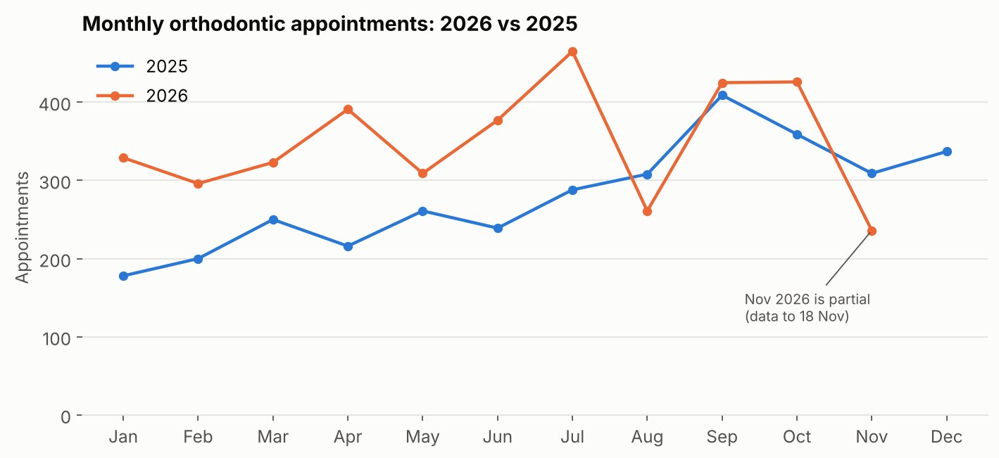
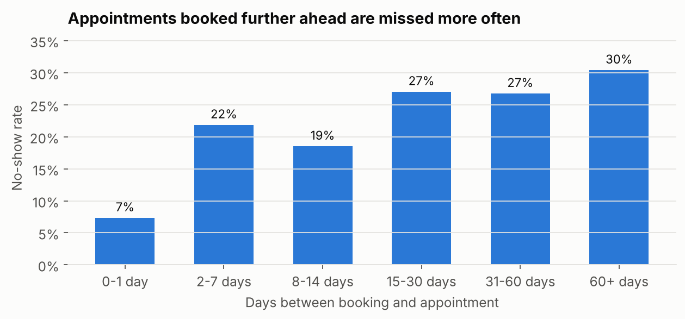
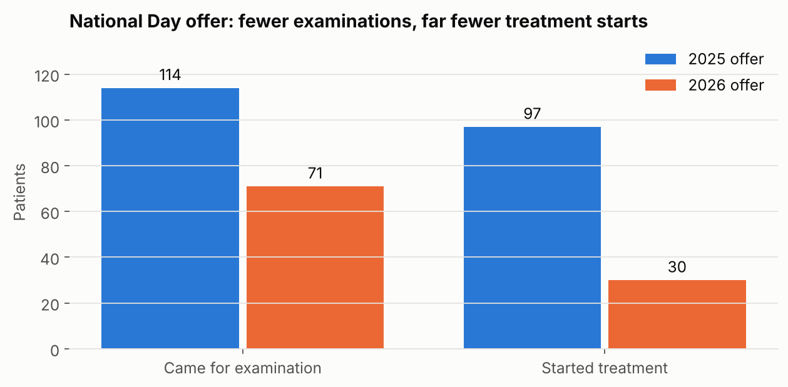

# Orthodontic Patient Flow & Offer Analytics

**Real-world healthcare analytics on about two years of data from a dental clinic in Saudi Arabia**

`Python` · `pandas` · `matplotlib` · `Jupyter / Google Colab` · `Data anonymisation`

> **Open in Colab:** [01_ortho_analysis.ipynb](https://colab.research.google.com/github/Nura-Alsaloul/ortho-retention-analytics/blob/main/notebooks/01_ortho_analysis.ipynb)

---

## The problem
Bright Smile Dental Clinic (Bisha, Saudi Arabia) runs a busy orthodontic clinic. Management wanted answers to three questions:
1. Is the clinic growing, and is the growth coming from **new** patients?
2. Why is about **1 in 5 appointments missed**?
3. In 2026 the clinic changed the terms of its **National Day offer** to open-ended monthly instalments. Did that change help or hurt?

## The data
| Table | Rows | Content |
|---|---|---|
| `appointments` | 7,224 | Every orthodontic appointment, Jan 2025 to Nov 2026: type, status, booking time, waiting time |
| `patients` | 900 | Treatment-status tags and payment plan |
| `payments` | 3,940 | Every payment, with amount, method and examination fees |

Source: exports from the clinic's practice-management system (Dentolize), **anonymised** before analysis.

## Key findings

**1. Growth comes from existing patients, not new ones.**
Appointments grew **33%** compared with the same period last year, driven by follow-up visits. Completed examinations fell **10%** and braces placements fell **13%**.



**2. No-shows are predictable.**
An appointment booked the same or next day is missed **7%** of the time. One booked 15 to 60 days ahead is missed **~27%** of the time. Patients with 4 or more previous no-shows miss **33%** of appointments.



**3. Case study: the open-ended offer coincided with a ~69% drop in treatment starts.**
| | 2025 offer (fixed total) | 2026 offer (open-ended) |
|---|---|---|
| Came for examination | 114 | 71 |
| Started treatment | **97 (85%)** | **30 (42%)** |
| Contract value of offer starters (24-month scenario) | 226,520 SAR | 133,084 SAR |

Most of the loss happens **after the examination**. Staff report that patients hesitate when the total cost is not known.



## Recommendations
1. **Cap the instalments** (for example 200 SAR/month, maximum 18 months) so patients know the total upfront.
2. **Send confirmations 2 days before** appointments booked more than a week ahead, and call patients with a history of no-shows.
3. Shift marketing toward **examination bookings**. Conversion was healthy (~85%) under a clear offer.

> **Limitations:** this is an observational before/after comparison, not a controlled experiment. It shows association, not proven cause. Ineligible patients are estimated from the 2025 baseline.

## Privacy & ethics
Raw exports contain personal health data and are **not** included in this repository. `src/anonymize.py`:
- replaces file numbers with pseudonymous codes (`P0001`, …)
- removes names, phone numbers, national IDs and staff names
- converts birth dates to age bands and nationality to Saudi / Non-Saudi
- maps free-text cancellation reasons to 8 categories, so no health details are kept
- fails if any phone number or file number remains in the output

Published with the clinic's permission.

## Repository structure
```
├── data/ortho_clinic_anonymized.xlsx   # anonymised dataset + data dictionary
├── notebooks/01_ortho_analysis.ipynb   # full analysis (runs on Colab)
├── figures/                            # charts used in this README
├── src/anonymize.py                    # privacy step: raw exports to anonymised data
├── src/build_notebook.py               # generates the notebook
└── requirements.txt
```

## Run it
```bash
git clone https://github.com/Nura-Alsaloul/ortho-retention-analytics
cd ortho-retention-analytics
pip install -r requirements.txt
jupyter notebook notebooks/01_ortho_analysis.ipynb
```

---
**Nura Jehad Alsaloul** · MSc Data Science · [LinkedIn](https://www.linkedin.com/in/noura-jehad)
